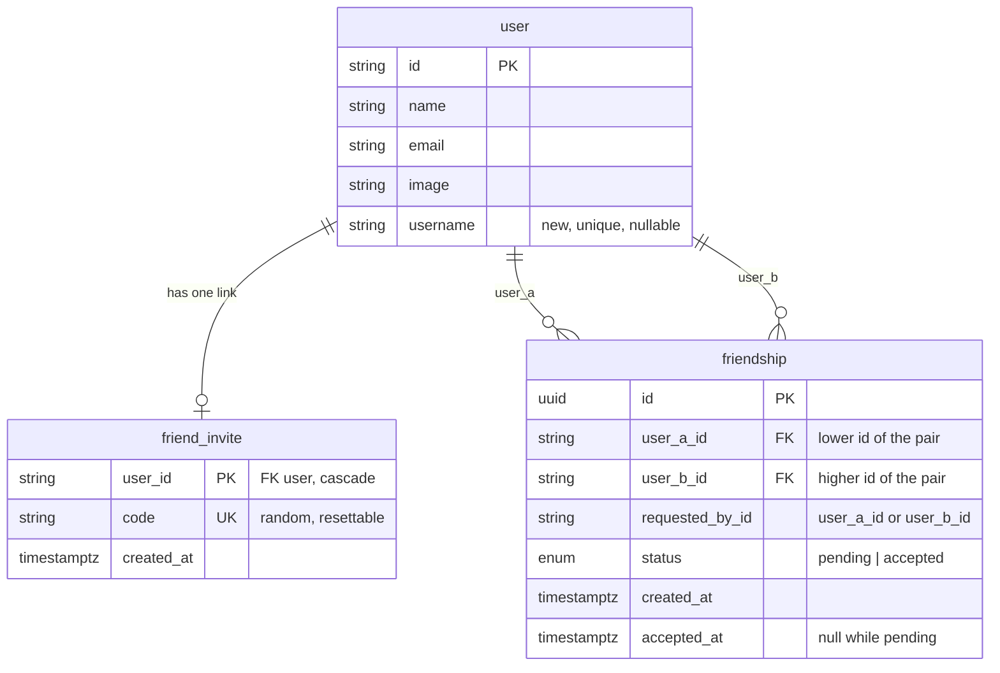

# Friends: connections (phase 1)

Date: 2026-10-31
Status: ready for review

## Why

The Friends tab exists (`src/features/friends/components/friends-screen.tsx`) but is a
placeholder. The long-term aim is accountability: see how your friends are doing with
their reading, check in on them, and be motivated by their progress.

None of that works until people can connect. This phase builds only the connection:
how two readers become friends, and how they stop being friends. Progress sharing is the
next phase and builds on the tables defined here.

## Goals

- A reader can invite people with a **personal invite link** shared outside the app
  (Messenger, SMS, a group chat).
- A reader can find someone **by their unique username** inside the app.
- Both paths create a **friend request** that the other person must accept. Nothing is
  shared before that.
- Friendship is **mutual**: once accepted, both readers are friends with each other.
  There is no one-way following.
- A reader can **decline** an incoming request, **cancel** a sent one, and **remove** a
  friend at any time. All of these are quiet: the other person is not notified.
- A reader can **reset their invite link** if it ends up somewhere it should not and
  strangers start sending requests. The old link stops working.

## Non-goals (this phase)

- Showing any reading progress, streaks or "read today" to friends. (Next phase.)
- Notifications of any kind (push, email, in-app badges outside the Friends tab).
- Blocking or reporting users. A leaked link can only produce requests, which the owner
  declines; resetting the link stops new ones.
- Search by name or email, suggestions, contacts import, "people you may know".
- Groups or reading circles.

## Anti-goals

- **Strangers browsing who uses the app.** Search must never list people by partial
  name or email. A reader's email is never shown to anyone else.
- **Anyone being added without consent.** No path (link, search, race between two
  requests) may produce a friendship the receiving person did not accept, except the
  case where both people asked for it (see "Crossed requests").
- **A link that adds people on open.** Opening `/add/<code>` must never send a request
  by itself (link previews, prefetching and crawlers would fire it). The reader taps a
  button.
- **A leaderboard feel.** Not relevant yet, but nothing in this phase should rank
  friends.

## Decisions made with Christian

1. Two ways in: invite link and username search.
2. Both create a request that the receiver accepts.
3. Mutual friendship only.
4. The invite link is **personal and reusable**: anyone who opens it can send a request,
   and the owner still accepts each one individually.
5. The link uses a **random code, not the username**, and the owner can **reset** it.
6. Usernames are picked **the first time a reader opens Friends** (or opens someone's
   invite link), not at sign-up.
7. Search is by **username only**.
8. Someone opening an invite link **without an account** signs up first, then lands back
   on the invite.
9. Remove, decline and cancel are all **quiet**.
10. **What strangers see** (see "Visibility before accepting"): name and photo on the
    invite page and on incoming requests; only `@username` in search results.

## Visibility before accepting

"Nothing is shared before accepting" means no reading data. Identity is shared like this:

| Where | Who sees it | Shown |
|---|---|---|
| Invite page `/add/<code>` | anyone holding the owner's link | owner's name, photo, `@username` |
| Incoming request | the receiver | requester's name, photo, `@username` |
| Search result | any signed-in reader typing an exact username | `@username` only |
| Sent (outgoing pending) | the requester | `@username` only |
| Friends list | each friend | name, photo, `@username` |

The reasoning: the link only reaches people its owner sent it to, and someone sending a
request has chosen to be seen. Search is the one place a stranger can go looking, so it
returns nothing that identifies a person beyond the handle. That is also why search
needs no rate limiting: guessing usernames only confirms that a handle exists.

*My call:* the Sent list shows `@username` only, even for a request sent from an invite
page where the name was visible. The DAL does not record how a request was made, which
keeps the rule simple: name and photo come from the invite, an incoming request, or a
friendship, never from your own outgoing request.

Email is never shown anywhere.

## Data model

Three changes to `prisma/schema.prisma`, in one migration. Follows the existing
conventions: snake_case columns via `@map`, `Timestamptz(3)`, UUID ids from
`gen_random_uuid()`, CHECK constraints hand-written in the migration SQL with a comment
(see `prisma/migrations/20261007140754_read_throughs/migration.sql`).



### `user.username` (new column)

```prisma
/// Public handle for finding friends. Null until the reader picks one.
username String? @unique
```

- Stored **lowercase**, always. Normalising on write (trim, strip a leading `@`,
  lowercase) makes uniqueness case-insensitive without `citext`.
- CHECK in SQL: `username ~ '^[a-z0-9_]{3,20}$'`. Letters, digits, underscore,
  3 to 20 characters.
- Nullable because every existing account has none yet. Postgres allows many NULLs in a
  unique index, which is what we want here.
- A plain column on Better Auth's `user` table. Better Auth's adapter ignores columns it
  does not know about, and the DAL writes it directly.
- *My call:* not using Better Auth's `username` plugin. It also turns on sign-in by
  username and reshapes sign-up, neither of which was asked for.

### `friend_invite` (new table)

```prisma
/// A reader's personal invite link. Reusable by anyone until reset.
model FriendInvite {
  userId    String   @id @map("user_id")
  code      String   @unique
  createdAt DateTime @default(now()) @map("created_at") @db.Timestamptz(3)

  user User @relation(fields: [userId], references: [id], onDelete: Cascade)

  @@map("friend_invite")
}
```

- One row per reader (`user_id` is the primary key). Created lazily the first time the
  reader's link is shown.
- **Reset** replaces `code` (and `created_at`) in place. The old code then matches
  nothing, so the old link shows "This invite link no longer works".
- `code`: 10 characters from `[A-Za-z0-9]`, from `crypto.getRandomValues` (about 59 bits:
  not guessable, short enough to look fine in a chat). CHECK in SQL:
  `code ~ '^[A-Za-z0-9]{10}$'`. On the rare unique collision, generate again.
- *My call:* a separate table rather than a column on `user`, to keep the auth table's
  additions to one column and leave room for later link settings without touching it.

### `friendship` (new table)

One row per pair of readers, holding both the pending request and the accepted
friendship.

```prisma
enum FriendshipStatus {
  pending
  accepted

  @@map("friendship_status")
}

/// A friend request (pending) or a friendship (accepted) between two readers.
///
/// The pair is stored in a fixed order (user_a_id < user_b_id), so A-to-B and B-to-A
/// are the same row and a plain unique index stops duplicates in either direction.
model Friendship {
  id            String           @id @default(dbgenerated("gen_random_uuid()")) @db.Uuid
  userAId       String           @map("user_a_id")
  userBId       String           @map("user_b_id")
  requestedById String           @map("requested_by_id")
  status        FriendshipStatus @default(pending)
  createdAt     DateTime         @default(now()) @map("created_at") @db.Timestamptz(3)
  acceptedAt    DateTime?        @map("accepted_at") @db.Timestamptz(3)

  userA User @relation("FriendshipUserA", fields: [userAId], references: [id], onDelete: Cascade)
  userB User @relation("FriendshipUserB", fields: [userBId], references: [id], onDelete: Cascade)

  @@unique([userAId, userBId])
  @@index([userBId])
  @@map("friendship")
}
```

Hand-written CHECKs in the migration:

- `user_a_id < user_b_id COLLATE "C"`: fixes the order and also rules out befriending
  yourself. Pinned to `"C"` so the database orders ids the same way JavaScript's `<`
  does when the DAL computes the pair.
- `requested_by_id IN (user_a_id, user_b_id)`.
- `(status = 'accepted') = (accepted_at IS NOT NULL)`.

`User` gains the two back-relations (`friendshipsAsA`, `friendshipsAsB`) and
`friendInvite FriendInvite?`.

Why one row per pair instead of two rows (one per direction) or separate request and
friendship tables:

- Mutual by construction: there is no way to store "A follows B but not the reverse".
- The unique index on the ordered pair makes a duplicate request impossible, including
  two people requesting each other at the same moment.
- Accept is a single `UPDATE`; decline, cancel and remove are a single `DELETE`.
- The next phase ("show my friends' progress") is one query:
  `status = 'accepted' AND (user_a_id = $me OR user_b_id = $me)`, served by the unique
  index (leading `user_a_id`) and `@@index([userBId])`.

Account deletion cascades through both tables, so a deleted reader vanishes from
everyone's list.

### State rules

| Action | Who | Before | After |
|---|---|---|---|
| Send request | anyone with a username | no row | `pending`, `requested_by_id` = sender |
| Send request, other side already asked (crossed requests) | sender | `pending` from the other person | `accepted` |
| Send request again | sender | `pending` from sender, or `accepted` | no change, report current state |
| Accept | receiver only | `pending` | `accepted`, `accepted_at = now()` |
| Decline | receiver only | `pending` | row deleted |
| Cancel | requester only | `pending` | row deleted |
| Remove friend | either | `accepted` | row deleted |
| Reset invite link | owner | code X | code Y; X stops working. Pending requests that came in through X stay. |

**Crossed requests:** if A has a pending request to B and B then requests A (by link or
search), both clearly want it, so it becomes accepted. This is the only path to
`accepted` other than an explicit accept.

**After a decline** the row is gone, so the sender sees "Add" again and could send
another request. Accepted for this phase (decline is quiet and there is no blocking). If
repeat requests become a problem, a later phase adds blocking.

## Flows

### Picking a username

- Opening Friends without a username shows a single step: "Pick a username" with the
  rules spelled out and a live "taken / available" check on submit.
- The same step appears inline on an invite page (below) when the reader has none, so a
  brand-new reader can pick one and send the request in one go.
- Validated with a Zod schema shared by client and server (`a-z`, `0-9`, `_`, 3 to 20,
  input normalised as above). A unique violation on save (two people racing for the
  same name) reports "That username was just taken".
- *My call:* the username can be changed later from the Friends screen. The old one is
  freed straight away. Friends are linked by id, so nothing breaks.
- *My call:* a short reserved list (`admin`, `support`, `bibletracker`, `friends`,
  `add`, `me`) is rejected.

### Invite link: `/add/<code>`

1. Owner opens Friends and sees "Your invite link" with **Copy** and **Share**
   (`navigator.share` where available, falling back to copy), plus **Reset link** behind
   a confirm ("People who haven't used your old link won't be able to").
2. Recipient opens the link.
   - **Signed out:** the proxy (`src/proxy.ts`) already redirects to
     `/sign-in?next=/add/<code>`, and the auth screens carry `next` through to sign-up
     (`src/features/auth/safe-next-path.ts`). No proxy change needed.
   - **Signed in:** the page shows the owner's photo, name and username, and a
     **Send friend request** button. Nothing is sent until the button is tapped.
3. Variants of the page:
   - Unknown or reset code: "This invite link no longer works. Ask your friend for a new
     one."
   - Your own code: "This is your invite link" with the copy/share buttons.
   - Already friends: "You're already friends" with a link to Friends.
   - Request already pending from you: "Request sent" with Cancel.
   - Pending request *from* the owner to you: tapping the button accepts (crossed
     requests).
   - No username yet: the username step inline, then the request.
4. After sending, go to Friends. A reader with no reading plan yet (a brand-new sign-up)
   goes to `/onboarding` instead, as the other app pages do. The request is already
   stored by then.

The page lives at `src/app/(app)/add/[code]/page.tsx`. It must **not** redirect to
onboarding before showing the invite, unlike the other `(app)` pages, or a new reader
would lose the invite. It needs a `@sheet/add` no-sheet entry like
`src/app/(app)/@sheet/friends/page.tsx`.

### Username search

- A search field on Friends. Input is normalised the same way as usernames; a lookup
  runs only for a valid username, and it is an **exact match**.
- Result: one `@username` (no name, no photo, a neutral avatar) with the right button
  for the current state: Add / Requested (Cancel) / Accept / Friends. Or "No one with
  that username". The DAL's `findUserByUsername` returns only the id and username, so
  the name and photo never reach the browser from search.
- Your own username returns "That's you".
- *My call:* exact match only, no prefix search, so the field cannot be used to list
  users.

### Friends screen layout (phase 1)

Replaces the placeholder in `friends-screen.tsx`. Top to bottom:

1. Header with the reader's own `@username`.
2. **Your invite link** panel: copy, share, reset.
3. **Find by username** search.
4. **Requests** (incoming): accept / decline. Hidden when empty.
5. **Sent** (outgoing pending, `@username` only): cancel. Hidden when empty.
6. **Friends**: photo, name, username, sorted by name. Remove via a menu with a confirm.
   Empty state explains how to invite someone.

The tab bar badge and any count of pending requests outside this screen are out of
scope.

## Limits

*My calls*, cheap guards against the leaked-link case, not product features:

- At most **50 outgoing pending** requests per reader. Beyond that: "You have a lot of
  requests waiting. Cancel some before sending more."
- At most **500 friends** per reader (well above any real use; it bounds the next
  phase's queries).
- Both checked inside the same transaction as the insert. The friend cap is checked for
  both people on accept, not only on send.
- **Decline all** in the Requests section once there are more than 5 incoming, behind a
  confirm. Covers a flood from a leaked link without capping incoming requests.

## Code layout

Following the existing structure:

- **`src/lib/dal.ts`**: the only module that queries the database
  (`src/lib/dal.ts:27`). New functions: `getUsername`, `setUsername`, `findUserByUsername`,
  `getOrCreateInvite`, `resetInvite`, `findInviteOwner`, `listFriendships` (returns
  friends, incoming and outgoing for a reader), `sendFriendRequest`,
  `acceptFriendRequest`, `deleteFriendship` (decline, cancel and remove, each checking
  the caller's role in the row). Return domain types, never Prisma rows. If the file
  grows uncomfortably, splitting the friends functions into a sibling module is the
  builder's call.
- **`src/features/friends/commands/`**: input parsing (Zod), result types with plain
  error copy, mirroring `src/features/reading-plan/commands/` (`results.ts` pattern of
  error codes plus a message function).
- **`src/actions/friends.ts`**: Server Actions, each starting with `requireUser()` as in
  `src/actions/reading.ts`.
- **`src/features/friends/components/`**: screen sections above, plus the username step.
- **`src/app/(app)/add/[code]/page.tsx`** and the `@sheet/add` no-sheet page.

Every friendship function takes the caller's `userId` and only acts on rows where the
caller is `user_a_id` or `user_b_id`, with the role check (requester vs receiver) done
in the `WHERE` clause, not after a read. Sending a request computes the ordered pair
and uses an upsert-style insert so concurrent requests resolve to one row.

## Testing

- **DB tests** (`*.db.test.ts`, like `src/lib/__tests__/isolation.db.test.ts`):
  - one row per pair whichever side asks; crossed requests accept;
  - only the receiver can accept or decline, only the requester can cancel, either can
    remove;
  - a reader cannot act on a friendship they are not in;
  - CHECK constraints reject self-friendship and bad usernames/codes;
  - reset makes the old code resolve to nothing and leaves pending requests alone;
  - account deletion cascades;
  - search and the Sent list never return a name or photo; incoming requests and the
    invite owner do;
  - limits enforced.
- **Unit tests**: username normalisation and validation, invite code format.
- Run `pnpm verify` before calling it done.

## Left to the builder

- Data loading for the Friends screen (server-rendered from the DAL with actions
  refreshing the route, or React Query like the reading screens). Match whatever is
  simplest given `src/app/(app)/layout.tsx`.
- Exact copy and visual design, within the existing components (`Panel`,
  `SectionHeader`, `EmptyState`, `alert-dialog`).
- Whether `listFriendships` is one query or three.
- How the public origin for the copied link is built (`BETTER_AUTH_URL` from
  `src/lib/env.ts` is already the app's base URL).
